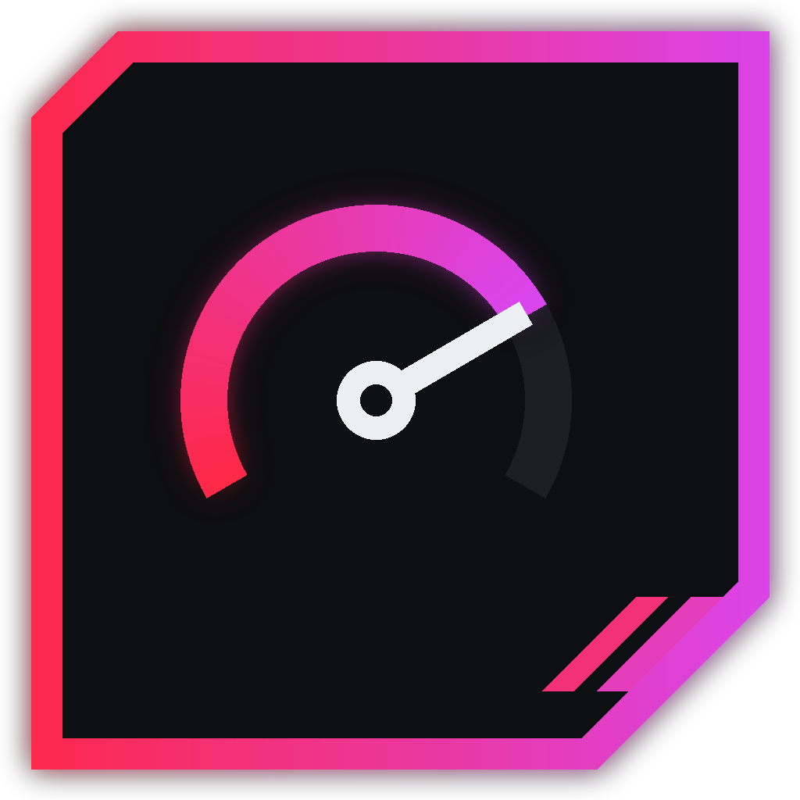

# Benchinho Toy 🎮

Monitor de FPS e recursos para jogos no Windows, com overlay por cima do jogo e relatórios em HTML.
Feito para descobrir o que trava o jogo de verdade: GPU, CPU, RAM cheia, paginação ou disco.



Visual escuro com destaques em vermelho e magenta (inspirado no estilo gamer "Strix", sem usar marcas).

## O que ele faz

- **Gravação de sessões** com FPS médio, 1% low, 0,1% low e contagem de travadas (frame > 2,5× a mediana)
- **Recursos por segundo:** CPU, RAM, paginação, GPU (uso, temperatura, watts, clock, VRAM via `nvidia-smi`) e leitura/gravação de cada disco
- **Detecção de foco:** trechos com o jogo minimizado ou fora de foco saem das estatísticas
- **Contexto do teste:** tela onde o jogo rodou (resolução e Hz), SSD onde o jogo está instalado e configurações gráficas do jogo (Unreal, Frostbite, registro, ini, xml)
- **Relatório HTML** com gráficos e **comparativo** entre sessões (mostra o que mudou de config de um teste para o outro)
- **Overlay** transparente por cima do jogo (o clique atravessa e ele não rouba o foco):
  - Compacto: FPS, 1% low, gráfico de frametime, CPU/GPU/RAM
  - Completo: + travadas/min, paginação (MB/s) e VRAM
- **Aba Consumo:** lista os programas que mais gastam CPU/RAM/disco e permite fechá-los
- **Atalhos globais:** `Ctrl+Alt+F10` inicia/para a gravação (com bipes) e `Ctrl+Alt+F11` mostra/esconde o overlay

## Como usar

1. Instale o Python 3.11+ e as dependências:
   ```
   pip install -r requirements.txt
   ```
2. Baixe o **PresentMon** da Intel (`PresentMon-2.x.x-x64.exe`) em
   <https://github.com/GameTechDev/PresentMon/releases> e coloque na pasta `bin\`.
3. Abra pelo `Abrir Monitor de Jogos.bat` (ou `pythonw monitor_jogos.py`).
   Ele pede administrador, porque o PresentMon precisa disso para ler os quadros dos jogos.
4. Para o overlay aparecer, o jogo precisa estar em **janela sem bordas** (ou na "tela cheia" não exclusiva).

As sessões ficam em `sessoes\`, cada uma com `relatorio.html`, `frames.csv` e `recursos.csv`.

## Arquivos

| Arquivo | Para quê |
|---|---|
| `monitor_jogos.py` | app (janela, gravação, overlay, relatórios) |
| `config_jogos.py` | leitura das configurações gráficas de cada jogo |
| `gerar_icone.py` | gera opções de ícone (`python gerar_icone.py`) e instala uma (`python gerar_icone.py D`) |

Requer Windows 10/11. As leituras de GPU usam `nvidia-smi` (placas NVIDIA).
